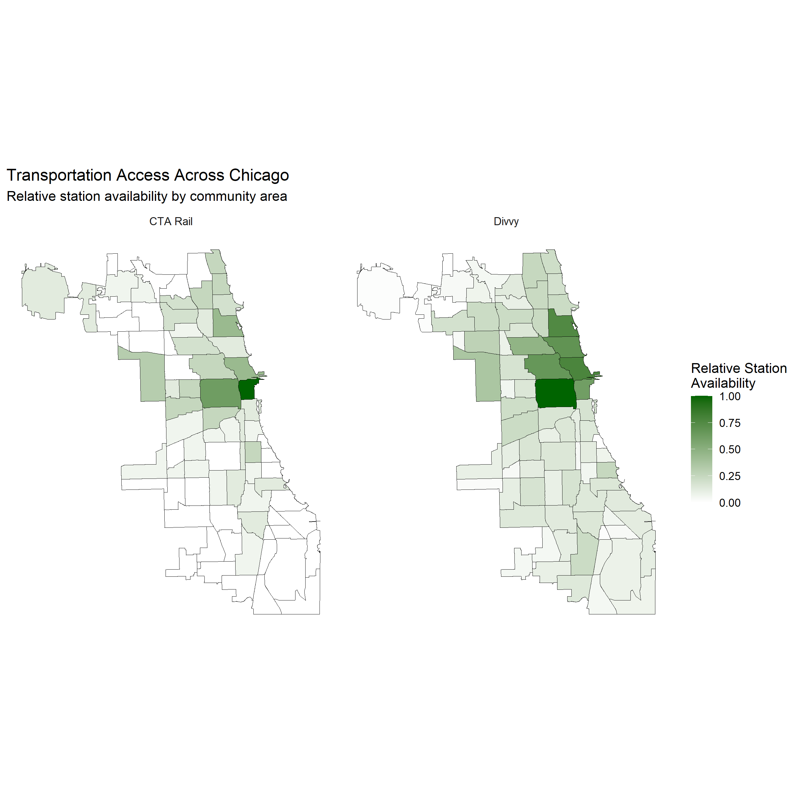
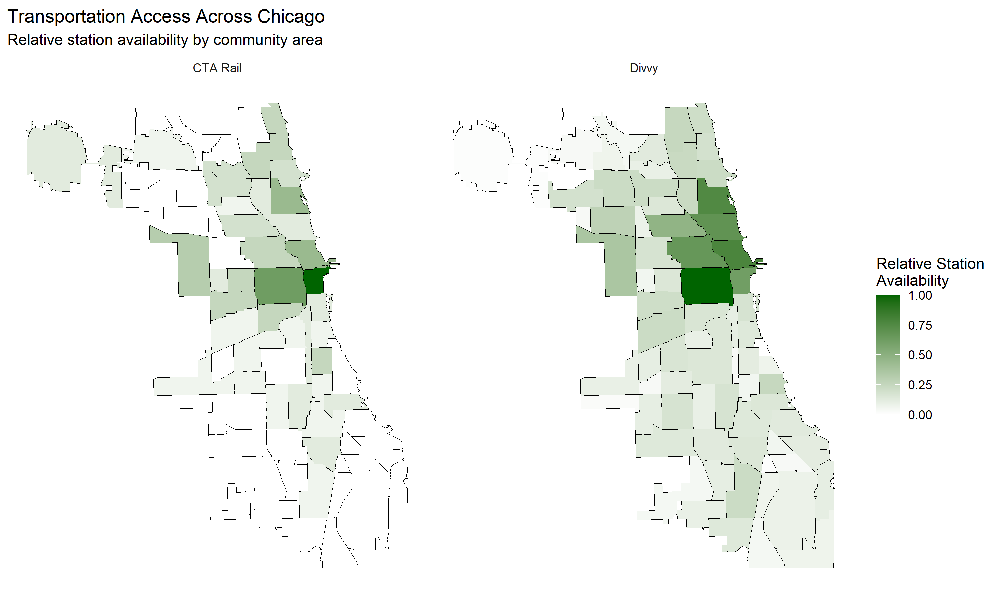

## Overview

Chicago has one of the largest public transportation networks in the United States, but access to different transportation options varies considerably across the city.

Some community areas have several CTA rail stations, dense Divvy bike-share infrastructure, or both. Others have far fewer stations within their boundaries.

This project examines the geographic distribution of **CTA rail stations and Divvy stations across Chicago's 77 community areas**. Rather than analyzing ridership, the project focuses on where transportation infrastructure is physically available and how that availability differs throughout the city.

The analysis uses spatial data in R to connect CTA and Divvy station locations with Chicago community area boundaries. It then compares both the physical distribution of stations and their relative availability across the city.

## Tools

- **R** for data cleaning and analysis
- **sf** for spatial data analysis
- **dplyr** for filtering and transforming data
- **tidyr** for restructuring data
- **ggplot2** for mapping and visualization
- **Quarto** for documenting and presenting the analysis

## Preparing the Data

Three datasets were used:

- Chicago Community Area boundaries
- CTA rail station locations
- Divvy station locations

The necessary packages and datasets were first loaded into R.

```{r}
library(sf)
library(ggplot2)
library(dplyr)
library(tidyr)

community_areas <- st_read(
  "data/community_areas.geojson"
)

cta_stations <- read.csv(
  "data/cta_stations.csv"
)

divvy_stations <- read.csv(
  "data/divvy_stations.csv"
)
```

The community area dataset contains the geographic boundaries for Chicago's 77 officially designated community areas.

The CTA and Divvy datasets contain station locations that can be converted into geographic points and matched to those boundaries.

## Preparing CTA Stations

The CTA dataset stores latitude and longitude together in a single `Location` variable.

The coordinates were separated and converted into numeric values before the stations were transformed into spatial points.

```{r}
cta_stations <- cta_stations %>%
  separate(
    Location,
    into = c("latitude", "longitude"),
    sep = ","
  ) %>%
  mutate(
    latitude = as.numeric(gsub("\\(", "", latitude)),
    longitude = as.numeric(gsub("\\)", "", longitude))
  )
```

The raw CTA file also contains more than one record for some physical stations because individual platforms or directions may appear separately.

To avoid counting the same physical station more than once, stations were reduced to one record using the unique `MAP_ID`.

```{r}
cta_stations_unique <- cta_stations %>%
  distinct(MAP_ID, .keep_all = TRUE)
```

This approach also avoids treating stations with the same name as the same physical location. For example, the Blue and Red Lines both have stations named Belmont and Addison, but their different `MAP_ID` values preserve them as separate stations.

## Matching CTA Stations to Community Areas

The CTA station data was converted into a spatial object using its longitude and latitude coordinates.

```{r}
cta_stations_sf <- st_as_sf(
  cta_stations_unique,
  coords = c("longitude", "latitude"),
  crs = 4326
)
```

Each station was then matched to the Chicago community area in which it is located.

```{r}
cta_with_community <- st_join(
  cta_stations_sf,
  community_areas["community"],
  join = st_intersects
)
```

Some CTA stations could not be assigned to a Chicago community area because the CTA rail system extends beyond Chicago's municipal boundaries.

Stations outside the city were therefore excluded from the community-area analysis.

```{r}
cta_chicago <- cta_with_community %>%
  filter(!is.na(community))
```

## Identifying CTA Transfer Stations

Because some CTA stations serve multiple rail lines, an additional measure was created to identify transfer stations.

```{r}
cta_chicago <- cta_chicago %>%
  mutate(
    line_count = rowSums(
      across(
        c(RED, BLUE, G, BRN, P, Pnk, O, Y),
        ~ toupper(as.character(.)) == "TRUE"
      )
    )
  )

transfer_stations <- cta_chicago %>%
  filter(line_count > 1)
```

This allows major transfer stations to be distinguished from stations served by only one rail line.

## Preparing Divvy Stations

Unlike the CTA dataset, the Divvy dataset already contains separate latitude and longitude variables.

The stations were converted directly into spatial points.

```{r}
divvy_stations_sf <- st_as_sf(
  divvy_stations,
  coords = c("Longitude", "Latitude"),
  crs = 4326
)
```

The same spatial matching process was then used to assign each Divvy station to a Chicago community area.

```{r}
divvy_with_community <- st_join(
  divvy_stations_sf,
  community_areas["community"],
  join = st_intersects
)

divvy_chicago <- divvy_with_community %>%
  filter(!is.na(community))
```

## Transportation Infrastructure Across Chicago

The first map shows the physical locations of CTA rail and Divvy stations throughout Chicago.



CTA rail stations are shown in red, while Divvy stations are shown in blue. CTA transfer stations are marked with an additional ring.

### Key Findings

- **CTA rail follows distinct geographic corridors.** Rail stations extend outward from Downtown along relatively narrow routes rather than being distributed evenly throughout the city.

- **Divvy has a much broader geographic footprint.** Bike-share stations cover large portions of Chicago that do not contain CTA rail stations.

- **Downtown has the strongest concentration of CTA rail infrastructure.** Many CTA lines converge near the center of the city, producing a dense cluster of rail stations and transfer opportunities.

- **Divvy is particularly dense across Downtown and the North Side.** Although stations extend considerably farther south and west, the highest concentration of bike-share infrastructure remains in the city's central and northern areas.

- **Some community areas have access to one system but relatively little of the other.** This suggests that transportation availability depends heavily on the mode being examined.

## Measuring Relative Station Availability

CTA and Divvy contain very different numbers of stations.

Because of this, directly comparing raw station counts would make Divvy appear substantially larger simply because the bike-share system contains far more individual stations.

First, the number of CTA and Divvy stations within each community area was calculated.

```{r}
cta_station_counts <- cta_chicago %>%
  st_drop_geometry() %>%
  count(
    community,
    name = "cta_stations"
  )

divvy_station_counts <- divvy_chicago %>%
  st_drop_geometry() %>%
  count(
    community,
    name = "divvy_stations"
  )
```

The station counts were then joined back to the community area boundaries. Community areas without a station were assigned a count of zero.

```{r}
access_map <- community_areas %>%
  left_join(
    cta_station_counts,
    by = "community"
  ) %>%
  left_join(
    divvy_station_counts,
    by = "community"
  ) %>%
  mutate(
    cta_stations = replace_na(cta_stations, 0),
    divvy_stations = replace_na(divvy_stations, 0)
  )
```

To compare their geographic patterns more clearly, station counts were converted into a **relative station availability measure** ranging from 0 to 1.

```{r}
access_map <- access_map %>%
  mutate(
    cta_access = cta_stations / max(cta_stations),
    divvy_access = divvy_stations / max(divvy_stations)
  )
```

A value of **1** represents the community area with the highest observed station count for that transportation mode.

For example, if the highest CTA station count among all community areas is 16, a community area with 8 CTA stations would receive a relative station availability value of 0.50.

This measure does not represent "perfect" transportation access. Instead, it shows how each community area compares with the highest observed station availability for CTA rail or Divvy.

## Relative Transportation Access



The two maps use the same 0-to-1 scale, making it easier to compare the geographic concentration of each transportation system.

### Key Findings

- **CTA rail availability is highly concentrated.** The darkest areas are clustered primarily around Downtown and communities located along major rail corridors.

- **Divvy availability is more geographically continuous.** Instead of following narrow corridors, bike-share stations form larger connected areas of relatively high availability.

- **North and central Chicago generally show stronger access to both systems.** Community areas in these portions of the city frequently appear darker on both maps.

- **Large portions of the South and Far South Sides show comparatively low station availability.** This is particularly visible for CTA rail, although Divvy infrastructure extends into more of these community areas.

- **The two networks complement each other in some locations but not uniformly across the city.** Areas without strong CTA rail availability may still have some Divvy infrastructure, while other areas show relatively limited access to both systems.

## Overall Findings

Several broader patterns emerge from the geographic comparison.

First, **CTA rail and Divvy represent very different types of transportation networks**. CTA rail is corridor-based, with stations concentrated along fixed rail lines and around major transfer points. Divvy is distributed more broadly and can place stations throughout neighborhoods without requiring rail infrastructure.

Second, **Downtown remains the strongest center of CTA rail access**. Because several rail lines converge in and around the Loop, central Chicago contains a much greater concentration of rail infrastructure than most other parts of the city.

Third, **Divvy expands transportation options beyond the CTA rail network**. Many community areas without direct rail access still contain bike-share stations. This gives Divvy the potential to supplement other forms of transportation, although station presence alone does not establish whether residents can realistically use the system for their daily travel needs.

Fourth, **transportation infrastructure is not distributed evenly across Chicago**. The maps show substantial differences between neighborhoods in both CTA rail and Divvy station availability.

Finally, **transportation access cannot be fully understood by examining a single mode**. A community area without a rail station may still have substantial bus service, Divvy infrastructure, Metra service, or other transportation options. Looking at CTA rail and Divvy together provides a broader picture, but it still represents only part of Chicago's transportation network.

## Data Limitations

This analysis measures **station availability**, not complete transportation accessibility.

The presence of a station within a community area does not necessarily mean that every resident has convenient access to that station.

Community areas vary significantly in geographic size and population. A large community area may contain several stations while still leaving many residents relatively far from them.

The analysis also does not include:

- CTA bus routes
- bus or rail service frequency
- walking distance to stations
- travel time
- station accessibility
- population density
- household income
- employment locations
- Divvy bike availability
- Divvy dock availability
- Metra service
- Pace service

Station counts also treat each station equally even though stations can differ substantially in service level, connectivity, ridership, and accessibility.

For these reasons, the maps should be interpreted as showing the **geographic distribution of CTA rail and Divvy infrastructure**, rather than a complete measure of mobility or transportation equity.

Future analysis could incorporate population, bus service, travel times, station accessibility, and demographic data to develop a more comprehensive measure of transportation access across Chicago.
